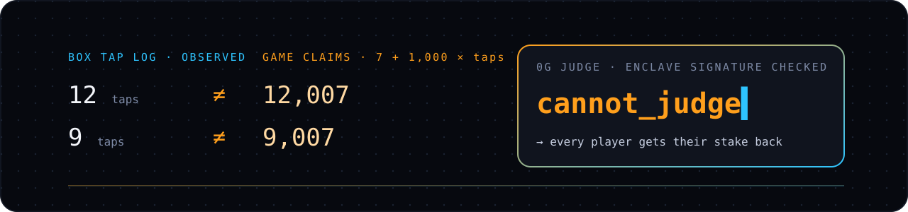
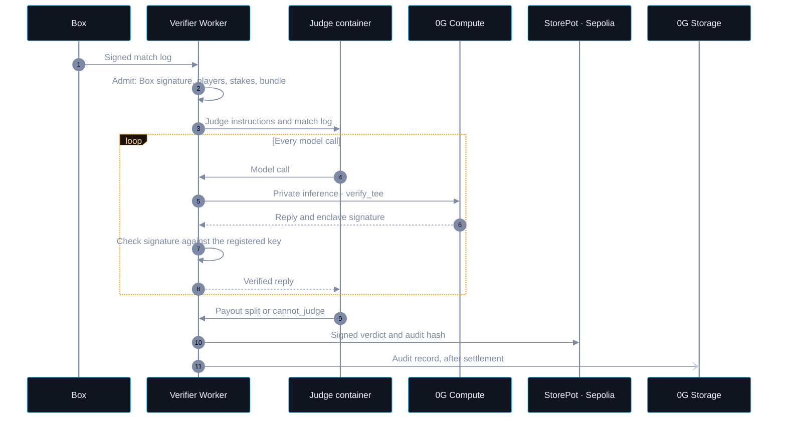
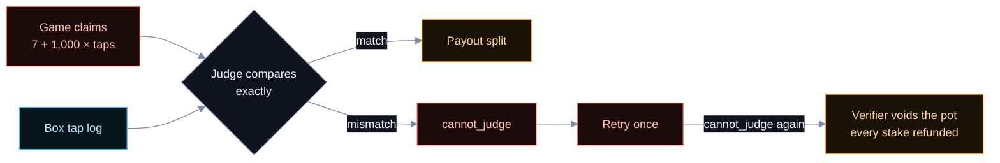

# 0G usage

## Submission description

Our game store uses an AI judge on 0G Compute's private inference to decide payouts from match logs. A Cloudflare Worker checks every turn's enclave signature against the provider's registered key in 0G's serving contract and rejects replies that fail. The judge compares the game's claims with the Box's own tap log. Our deliberately rigged game reports inflated scores to test that check. If inference fails or the judge cannot produce a valid verdict after a retry, every player gets their stake back. The verifier commits each judgement's audit hash on Sepolia and queues the full record for 0G Storage. Real store matches have been judged and settled on Sepolia, including a 20 test-USDC payout and a rigged-game refund.

## Where 0G is used

| Use | What the code does | GitHub code |
| --- | --- | --- |
| **Private inference** | Sets `verify_tee: true` and `x-0g-provider-trust-mode: private` on model calls to 0G. | [Request body](https://github.com/TaraxioT/ethereum-game-box/blob/980270430130e4dfa2e884d82997b72c821d12c7/apps/verifier/src/proxy.ts#L30-L35) · [0G request](https://github.com/TaraxioT/ethereum-game-box/blob/980270430130e4dfa2e884d82997b72c821d12c7/apps/verifier/src/proxy.ts#L63-L72) |
| **Provider lookup** | Reads `getService(provider)` from 0G's serving contract through viem. | [zg-chain.ts:8-18](https://github.com/TaraxioT/ethereum-game-box/blob/980270430130e4dfa2e884d82997b72c821d12c7/apps/verifier/src/zg-chain.ts#L8-L18) |
| **Enclave verification** | Requires a sealed response, a `TeeML` provider, an acknowledged enclave key, and a signature that recovers to that key. Rejects replies that fail. | [Signature check](https://github.com/TaraxioT/ethereum-game-box/blob/980270430130e4dfa2e884d82997b72c821d12c7/apps/verifier/src/tee.ts#L94-L112) · [Reply rejection](https://github.com/TaraxioT/ethereum-game-box/blob/980270430130e4dfa2e884d82997b72c821d12c7/apps/verifier/src/proxy.ts#L89-L106) |
| **Judge instructions** | Treats Box entries as observations and game entries as claims. The agent submits a payout split or `cannot_judge`. | [prompt.ts:7-32](https://github.com/TaraxioT/ethereum-game-box/blob/980270430130e4dfa2e884d82997b72c821d12c7/apps/verifier/container/src/prompt.ts#L7-L32) |
| **Match admission** | Checks the Box signature and matches players, stakes, and bundle against the open pot. Judge instructions come from the published bundle. | [admit.ts:65-101](https://github.com/TaraxioT/ethereum-game-box/blob/980270430130e4dfa2e884d82997b72c821d12c7/apps/verifier/src/admit.ts#L65-L101) |
| **Container access** | Routes model calls through the Worker. The container has no general internet access or API keys. | [Worker proxy](https://github.com/TaraxioT/ethereum-game-box/blob/980270430130e4dfa2e884d82997b72c821d12c7/apps/verifier/src/container.ts#L32-L50) · [Allowed host](https://github.com/TaraxioT/ethereum-game-box/blob/980270430130e4dfa2e884d82997b72c821d12c7/apps/verifier/src/container.ts#L89) |
| **Audit hash** | Hashes the exact audit JSON. The signed verdict carries that hash into `StorePot` on Sepolia. | [Record hash](https://github.com/TaraxioT/ethereum-game-box/blob/980270430130e4dfa2e884d82997b72c821d12c7/apps/verifier/src/audit.ts#L12-L14) · [Onchain record](https://github.com/TaraxioT/ethereum-game-box/blob/980270430130e4dfa2e884d82997b72c821d12c7/contracts/src/game/StorePot.sol#L84-L102) |
| **0G Storage** | Uploads the record using the 0G Storage SDK. Uploads happen after settlement and retry without delaying payouts. | [SDK upload](https://github.com/TaraxioT/ethereum-game-box/blob/980270430130e4dfa2e884d82997b72c821d12c7/apps/verifier/src/zg-storage.ts#L112-L132) · [Durable retry](https://github.com/TaraxioT/ethereum-game-box/blob/980270430130e4dfa2e884d82997b72c821d12c7/apps/verifier/src/judge.ts#L479-L499) |
| **Refunds** | Retries a failed judgement once, then signs a void that returns every stake. Anyone can refund an open pot after one hour. | [Failed judgement](https://github.com/TaraxioT/ethereum-game-box/blob/980270430130e4dfa2e884d82997b72c821d12c7/apps/verifier/src/judge.ts#L327-L365) · [Contract refunds](https://github.com/TaraxioT/ethereum-game-box/blob/980270430130e4dfa2e884d82997b72c821d12c7/contracts/src/game/StorePot.sol#L106-L123) |

## The rigged game

The game reports `7 + 1,000 × taps` for each player. Its published judge instructions require an exact comparison with the Box's recorded tap counts. A mismatch must return `cannot_judge`; after the retry, the verifier voids the pot and refunds the players.

- [Inflated scores in the game code](https://github.com/TaraxioT/ethereum-game-box/blob/980270430130e4dfa2e884d82997b72c821d12c7/apps/store/sample/rigged-game/index.html#L35-L42).
- [Score event submitted to the match log](https://github.com/TaraxioT/ethereum-game-box/blob/980270430130e4dfa2e884d82997b72c821d12c7/apps/store/sample/rigged-game/index.html#L75-L90).
- [The judge comparison and refusal rules](https://github.com/TaraxioT/ethereum-game-box/blob/980270430130e4dfa2e884d82997b72c821d12c7/apps/store/sample/rigged-game/manifest.json#L10-L11).

## Live proof

Verified on November 7, 2026, against the deployed verifier, the [store index](https://gamebox-store.mathew.workers.dev/index.json), and successful Sepolia transaction receipts.

- **Tap Rush, `mumbai-01/51`.** The verifier reports `paid` with payouts `[0, 20000000]` in token base units. The `PotSettled` event records the 20 test-USDC payout and audit hash. [Live status](https://gamebox-verifier.mathew.workers.dev/judge/mumbai-01/51) · [Transaction](https://sepolia.etherscan.io/tx/0xbaf667d1f6c44ce63687ac615895b28f8b9db7d0cfa98cedf8de4e984c2684a8).
- **Rigged game, `mumbai-01/55`.** The verifier reports `refunded` after both attempts returned `cannot_judge`. The `PotVoided` event records the refund of each player's 5 test USDC and its audit hash. [Live status](https://gamebox-verifier.mathew.workers.dev/judge/mumbai-01/55) · [Transaction](https://sepolia.etherscan.io/tx/0x532eb497e040530385df54ed3f37c2b80f02eb3dd42ea4f704d37d01316c2faa).

> [!NOTE]
> The [round 51 audit endpoint](https://gamebox-verifier.mathew.workers.dev/audit/mumbai-01/51) currently has an audit hash but no Storage root or transaction. Its upload is pending; its payout and onchain hash are confirmed.

> [!IMPORTANT]
> The enclave check proves that a registered enclave handled the chat ID. It does not cryptographically bind the readable prompt or response to the signature. See [the precise scope of the check](https://github.com/TaraxioT/ethereum-game-box/blob/980270430130e4dfa2e884d82997b72c821d12c7/apps/verifier/src/tee.ts#L1-L8).

## Local verification

`pnpm store:e2e` runs the full store flow locally with 0G faked. It covers payouts, failed enclave checks, refunds, and delayed storage uploads. These scenarios are separate from the live matches above. [Payout scenario](https://github.com/TaraxioT/ethereum-game-box/blob/980270430130e4dfa2e884d82997b72c821d12c7/apps/store-e2e/test/store.e2e.ts#L195-L248) · [Storage outage scenario](https://github.com/TaraxioT/ethereum-game-box/blob/980270430130e4dfa2e884d82997b72c821d12c7/apps/store-e2e/test/store.e2e.ts#L465-L511).

> [!NOTE]
> Code links are public GitHub permalinks pinned to commit `9802704`, so their line references remain stable when posted.
