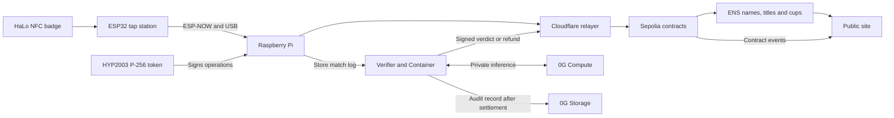

<div align="center">
  
  <h1>Ethereum Game Box</h1>
  <p>A tabletop console where friends tap NFC wallet badges to play for prizes on Ethereum.</p>
  <p>
    <a href="https://gamebox-names.pages.dev">Explore the live names</a> ·
    <a href="ens-usage.md">ENS integration</a> ·
    <a href="0g-usage.md">0G integration</a> ·
    <a href="#run-it-locally">Run it locally</a>
  </p>
  <p>Built at ETHGlobal Mumbai 2026. Game Box contracts run on Sepolia. Matches use test USDC.</p>
</div>

---

## A console for a table of friends

The Box is a Raspberry Pi 5 with a touchscreen, speaker, wireless NFC tap stations, and a hardware signing key. Players carry HaLo NFC wallet badges. Nobody at the table needs a wallet app, ETH for gas, or transaction pop-ups.

1. Tap a badge to receive 100 test USDC, then claim a name such as `alice.gamebox.eth`.
2. Choose a game. Each player taps to stake.
3. Play. The Box signs the result, or a store game's AI judge decides the payout.
4. The contract pays the players. A built-in game's signed result can also move its ENS title and score an open cup.

If a match remains unsettled, anyone can trigger a refund after one hour.

## What makes it work

| Technology | What we built with it | Code |
| --- | --- | --- |
| NFC chips | HaLo badges hold each player's keys. The Pi reads public keys and verifies chip-signed random rolls through libhalo. | [Chip operations](https://github.com/TaraxioT/ethereum-game-box/blob/980270430130e4dfa2e884d82997b72c821d12c7/apps/box/src/taps/chip-ops.ts#L36-L83) |
| Hardware P-256 | A HYP2003 USB token signs name claims, stakes, and results. Its private key stays in the token. Ethereum checks signatures through `P256VERIFY`. | [Token signing](https://github.com/TaraxioT/ethereum-game-box/blob/980270430130e4dfa2e884d82997b72c821d12c7/deploy/p256-signer/hyp2003_signer.py#L229-L244) · [Onchain verification](https://github.com/TaraxioT/ethereum-game-box/blob/980270430130e4dfa2e884d82997b72c821d12c7/contracts/src/box/P256.sol#L15-L25) |
| ENSv2 | Box licenses, player names, expiring champion titles, and cups with live standings. A finished cup becomes a trophy name owned by its winner. | [Box names](https://github.com/TaraxioT/ethereum-game-box/blob/980270430130e4dfa2e884d82997b72c821d12c7/contracts/src/names/GameBoxNames.sol#L145-L175) · [Cup trophies](https://github.com/TaraxioT/ethereum-game-box/blob/980270430130e4dfa2e884d82997b72c821d12c7/contracts/src/names/Championships.sol#L116-L140) |
| 0G Compute | An AI judge reads store match logs through private inference. The verifier checks each turn's enclave signature before accepting its reply. | [Private inference](https://github.com/TaraxioT/ethereum-game-box/blob/980270430130e4dfa2e884d82997b72c821d12c7/apps/verifier/src/proxy.ts#L63-L106) · [Enclave checks](https://github.com/TaraxioT/ethereum-game-box/blob/980270430130e4dfa2e884d82997b72c821d12c7/apps/verifier/src/tee.ts#L94-L112) |
| 0G Storage | The verifier commits each audit hash on Sepolia and queues the record for upload after settlement. | [Audit upload](https://github.com/TaraxioT/ethereum-game-box/blob/980270430130e4dfa2e884d82997b72c821d12c7/apps/verifier/src/zg-storage.ts#L112-L132) |
| Cloudflare | Workers and Durable Objects relay transactions, host the store, and coordinate judging in Containers. The relayer pays the gas. | [Relayer](apps/relayer/README.md) · [Verifier container](https://github.com/TaraxioT/ethereum-game-box/blob/980270430130e4dfa2e884d82997b72c821d12c7/apps/verifier/src/container.ts#L32-L50) |

Operators stake GBX to activate or extend a Box's ENS license. Expired or inactive Boxes cannot authorize game operations.

The tap is the player's consent to stake. The Box signs the stake with its hardware key; the badge does not sign a spending transaction. This prototype uses test USDC.

## The games

| Game | How it plays |
| --- | --- |
| [Quick Draw](apps/box/src/games/README.md#quick-draw-quick-draw) | The first tap after "draw" wins. |
| [Stock Duel](apps/box/src/games/README.md#stock-duel-stock-duel) | A best-of-three card game played with stocks. |
| [Tap Rush](apps/store/sample/tap-rush/manifest.json) | The most taps in ten seconds wins the pot. A 0G-powered judge counts the Box's recorded taps. |
| [Rigged game](apps/store/sample/rigged-game/manifest.json) | Deliberately reports inflated scores. The judge compares its claims with the Box's tap log and returns `cannot_judge`, which refunds the stakes. |

## How the pieces connect



The public site reads ENS through the Universal Resolver and discovers names from contract events. It has no backend or database.

## Real matches on Sepolia

- **Tap Rush paid out.** `mumbai-01`, round 51, paid a 20 test-USDC pot to the winner. [Settlement transaction](https://sepolia.etherscan.io/tx/0xbaf667d1f6c44ce63687ac615895b28f8b9db7d0cfa98cedf8de4e984c2684a8).
- **The rigged game refunded.** Round 55 ended with `cannot_judge` and returned each player's 5 test USDC. [Refund transaction](https://sepolia.etherscan.io/tx/0x532eb497e040530385df54ed3f37c2b80f02eb3dd42ea4f704d37d01316c2faa).

See [0G usage](0g-usage.md) for live verifier responses, audit status, and code links. Contract addresses live in [deployments/sepolia.json](deployments/sepolia.json).

## Run it locally

Requires Node.js 26 or newer and pnpm 12.3.4. Contract checks also need Foundry and the contract dependencies.

```sh
cp .env.example .env
pnpm install
pnpm --filter @egb/box build:box
EGB_RECEIVER=fake EGB_FORGE_PROVIDER=sim node apps/box/src/server/main.ts
```

Open <http://127.0.0.1:8790/> to use the Box with simulated badges and stations.

```sh
pnpm typecheck
pnpm test
pnpm contracts:install
pnpm contracts:test
pnpm firmware:test
```

The store's full local integration run is `pnpm store:e2e`. It uses real Workers, a container, the Box, and contracts on Anvil, with 0G and hardware faked. See [its prerequisites](apps/store-e2e/README.md#run). For hardware setup, see the [Pi guide](deploy/pi/README.md), [signer guide](deploy/p256-signer/README.md), and [tap-station firmware](firmware/tap-station/README.md).

## Repository

| Path | Responsibility |
| --- | --- |
| [apps/box](apps/box/README.md) | Pi server, touchscreen, NFC taps, and games |
| [apps/relayer](apps/relayer/README.md) | Signed requests and gas payments |
| [apps/verifier](apps/verifier/README.md) | AI judge, enclave checks, verdicts, and audit uploads |
| [apps/store](apps/store/README.md) | Game listings and bundles in R2 |
| [apps/web](apps/web/README.md) | Public ENS directory, titles, and cups |
| [apps/demo-box](apps/demo-box/README.md) | Software-key demo Box and ENS heartbeat |
| [contracts](contracts/README.md) | Names, pots, championships, GBX, licenses, and staking |
| [packages/sdk](packages/sdk/README.md) | Game manifests and match-log protocols |
| [packages/shared](packages/shared/README.md) · [packages/ui](packages/ui/README.md) | Shared types, ABIs, addresses, and UI |
| [apps/store-e2e](apps/store-e2e/README.md) | Local store integration scenarios |

## Team

[beingentangled](https://github.com/beingentangled) · [saithyasivadas](https://github.com/saithyasivadas) ·
[Athuli7](https://github.com/Athuli7) · [lizgeorge1](https://github.com/lizgeorge1) ·
[0xgeorgemathew](https://github.com/0xgeorgemathew)

[Project plan](plan/README.md) · [Live plan](https://plans.georgekm.com/ethereum-game-box-2026-11-05/)
