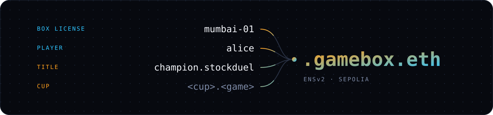
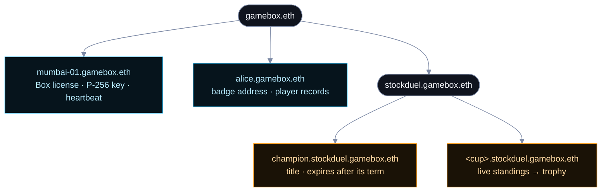
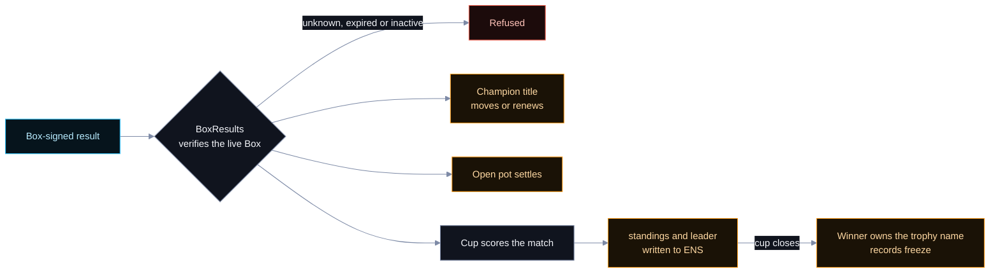

# ENS usage

## Submission description

Every registered Box and player has a `gamebox.eth` name on ENSv2 on Sepolia. Our GameBoxNames contract issues the names. A Box name carries its P-256 public key and status, and expires with its license. A player claims a name with one badge tap; the badge owns the name and controls its records, with a scoped permission for the stats contract. Titles such as `champion.stockduel.gamebox.eth` move to winners after a Box-signed result and expire after their term. Cups keep live standings in ENS records. When a cup closes, its winner receives the name and its final records freeze. Our demo Box writes a `lastSeen` heartbeat every five minutes. The public site reads ENS through the Universal Resolver and lists names from contract events, with no backend or database.

## Licenses, titles, and cups

| Name | What ENS holds |
| --- | --- |
| `mumbai-01.gamebox.eth` | A Box's account, P-256 public key, status, operator metadata, current game, and heartbeat. Its name expires with its license. |
| `alice.gamebox.eth` | A player's badge address and player records. Player names have no individual expiry, subject to the parent `gamebox.eth` name. |
| `champion.stockduel.gamebox.eth` | The champion's address and name, streak, round, and title expiry. Stock Duel's term is seven days; Quick Draw's is 15 minutes. |
| `<cup>.<game>.gamebox.eth` | A cup's deadline, prize, standings, and leader. At close, the winner owns the trophy name with no individual expiry and the records freeze. |

## Where ENS is used

| Use | What the code does | GitHub code |
| --- | --- | --- |
| **ENSv2 registries** | Deploys per-game registries with a locked parent and initializes permissioned resolvers. | [GameBoxNames.sol:425-446](https://github.com/TaraxioT/ethereum-game-box/blob/980270430130e4dfa2e884d82997b72c821d12c7/contracts/src/names/GameBoxNames.sol#L425-L446) |
| **Box licenses** | Registers the Box name to its operator with a license expiry. The licensor can renew it, change status, or rotate its key. | [GameBoxNames.sol:145-194](https://github.com/TaraxioT/ethereum-game-box/blob/980270430130e4dfa2e884d82997b72c821d12c7/contracts/src/names/GameBoxNames.sol#L145-L194) |
| **GBX activation** | Staking GBX activates a Box or extends its lease, then registers or renews its ENS name. | [GBX stake](https://github.com/TaraxioT/ethereum-game-box/blob/980270430130e4dfa2e884d82997b72c821d12c7/contracts/src/staking/BoxLease.sol#L41-L57) · [Name activation](https://github.com/TaraxioT/ethereum-game-box/blob/980270430130e4dfa2e884d82997b72c821d12c7/contracts/src/staking/BoxLease.sol#L99-L108) |
| **P-256 identity and permissions** | Writes `addr`, `boxKey`, and `status`. The operator edits metadata; the Box account writes its `lastSeen` and `game` records. | [Resolver permissions](https://github.com/TaraxioT/ethereum-game-box/blob/980270430130e4dfa2e884d82997b72c821d12c7/contracts/src/names/GameBoxNames.sol#L467-L488) |
| **License enforcement** | Refuses signed operations from an unknown, expired, or inactive Box before checking its signature. | [BoxCheck.sol:11-22](https://github.com/TaraxioT/ethereum-game-box/blob/980270430130e4dfa2e884d82997b72c821d12c7/contracts/src/names/BoxCheck.sol#L11-L22) |
| **One-tap player claims** | The Pi signs a `Seat`. `BoxSeats` verifies the live Box's signature and calls `claimPlayerFor`. | [Pi claim](https://github.com/TaraxioT/ethereum-game-box/blob/980270430130e4dfa2e884d82997b72c821d12c7/apps/box/src/chain/port.ts#L215-L218) · [Onchain claim](https://github.com/TaraxioT/ethereum-game-box/blob/980270430130e4dfa2e884d82997b72c821d12c7/contracts/src/names/BoxSeats.sol#L25-L30) |
| **Player ownership** | Gives the badge ownership and resolver permissions. The registrar drops its resolver role after granting the stats writer access to `stats`. | [GameBoxNames.sol:274-292](https://github.com/TaraxioT/ethereum-game-box/blob/980270430130e4dfa2e884d82997b72c821d12c7/contracts/src/names/GameBoxNames.sol#L274-L292) |
| **Signed wins** | Verifies the Box result, crowns the winner, settles an open pot, and scores the cup. | [BoxResults.sol:50-66](https://github.com/TaraxioT/ethereum-game-box/blob/980270430130e4dfa2e884d82997b72c821d12c7/contracts/src/names/BoxResults.sol#L50-L66) |
| **Expiring titles** | Moves the champion name or renews it for a repeat win, then writes the streak and round. | [Title transfer](https://github.com/TaraxioT/ethereum-game-box/blob/980270430130e4dfa2e884d82997b72c821d12c7/contracts/src/names/GameBoxNames.sol#L347-L370) · [Title terms](https://github.com/TaraxioT/ethereum-game-box/blob/980270430130e4dfa2e884d82997b72c821d12c7/contracts/script/names/AddGames.s.sol#L7-L14) |
| **Live cup standings** | Scores matches and writes `standings`, the leader's name, and the leader's address to ENS. | [Scoring](https://github.com/TaraxioT/ethereum-game-box/blob/980270430130e4dfa2e884d82997b72c821d12c7/contracts/src/names/Championships.sol#L98-L112) · [Resolver writes](https://github.com/TaraxioT/ethereum-game-box/blob/980270430130e4dfa2e884d82997b72c821d12c7/contracts/src/names/Championships.sol#L244-L251) |
| **Cup trophies** | Pays the prize, registers the cup name to its winner, and revokes the resolver's remaining write permissions. | [Championships.sol:116-140](https://github.com/TaraxioT/ethereum-game-box/blob/980270430130e4dfa2e884d82997b72c821d12c7/contracts/src/names/Championships.sol#L116-L140) |
| **Five-minute heartbeat** | Signs `lastSeen` writes through `P256Account.execute`. A Durable Object alarm schedules each heartbeat. | [Signed write](https://github.com/TaraxioT/ethereum-game-box/blob/980270430130e4dfa2e884d82997b72c821d12c7/apps/demo-box/src/box.ts#L89-L107) · [Interval](https://github.com/TaraxioT/ethereum-game-box/blob/980270430130e4dfa2e884d82997b72c821d12c7/apps/demo-box/src/object.ts#L19-L20) · [Alarm](https://github.com/TaraxioT/ethereum-game-box/blob/980270430130e4dfa2e884d82997b72c821d12c7/apps/demo-box/src/object.ts#L111-L123) |
| **Universal Resolver** | Uses viem's `getEnsAddress`, `getEnsText`, and `getEnsName` with the ENSv2 Universal Resolver. | [ens.ts:6-38](https://github.com/TaraxioT/ethereum-game-box/blob/980270430130e4dfa2e884d82997b72c821d12c7/apps/web/src/ens.ts#L6-L38) |
| **Directory without a database** | Discovers names from contract events, then reads their ENS records. | [Event discovery](https://github.com/TaraxioT/ethereum-game-box/blob/980270430130e4dfa2e884d82997b72c821d12c7/apps/web/src/directory.ts#L156-L165) · [Cup record reads](https://github.com/TaraxioT/ethereum-game-box/blob/980270430130e4dfa2e884d82997b72c821d12c7/apps/web/src/cups.ts#L43-L59) |
| **ENSIP-26 agent records** | `bot.gamebox.eth` publishes `agent-context` and `agent-endpoint[mcp]` through signed resolver writes. | [Agent records](https://github.com/TaraxioT/ethereum-game-box/blob/980270430130e4dfa2e884d82997b72c821d12c7/apps/demo-box/src/agent.ts#L92-L95) · [Record publishing](https://github.com/TaraxioT/ethereum-game-box/blob/980270430130e4dfa2e884d82997b72c821d12c7/apps/demo-box/src/agent.ts#L153-L159) |

## Explore it

- [Public directory, titles, and cups](https://gamebox-names.pages.dev).
- [GameBoxNames on Sepolia](https://sepolia.etherscan.io/address/0x07D464bcE29D85A09590666febE37ab4FDC8Ff9a#code).
- [Championships on Sepolia](https://sepolia.etherscan.io/address/0x8222774A2eD41E3c38A188A8143D29EF77957eA0#code).
- [Deployment addresses and ENSv2 infrastructure](https://github.com/TaraxioT/ethereum-game-box/blob/980270430130e4dfa2e884d82997b72c821d12c7/deployments/sepolia.json#L1-L154).

> [!NOTE]
> Code links are public GitHub permalinks pinned to commit `9802704`, so their line references remain stable when posted.
