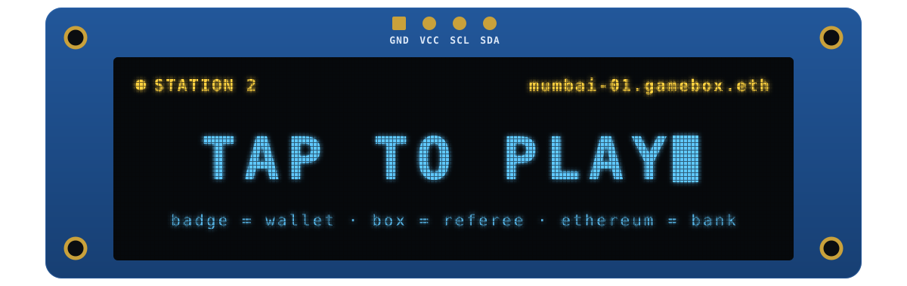
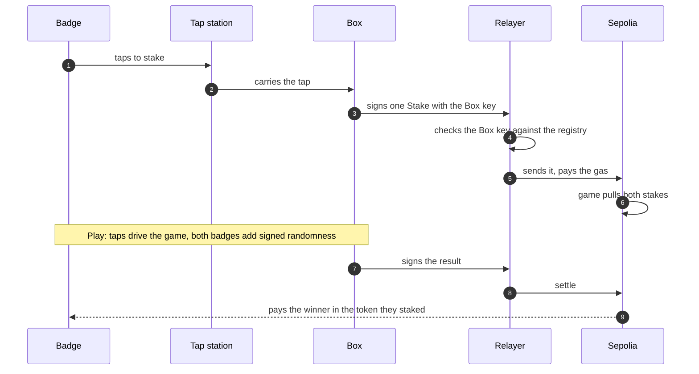

  

<h1 align="center">Ethereum Game Box</h1>

  A game console you play by tapping a badge. 
  Every match is staked and settled on Ethereum, and nobody at the table needs ETH, a wallet app or a single pop-up.

  ETHGlobal Mumbai 2026 &nbsp;·&nbsp; <a href="https://plans.georgekm.com/ethereum-game-box-2026-11-05/">Plan on the web</a> &nbsp;·&nbsp; <a href="index.html">Plan source</a>

  <a href="#what-it-is">What it is</a> &nbsp;·&nbsp;
  <a href="#how-it-works">How it works</a> &nbsp;·&nbsp;
  <a href="#games-and-the-token">Games and the token</a> &nbsp;·&nbsp;
  <a href="#partner-tracks">Partner tracks</a> &nbsp;·&nbsp;
  <a href="#where-we-are">Where we are</a> &nbsp;·&nbsp;
  <a href="#how-we-get-there">How we get there</a>

 

> [!NOTE]
> **In one sentence:** the badge is the wallet, the Box is the referee, and Ethereum is the bank.

> [!NOTE]
> The sections up to Partner tracks describe the design. [Where we are](#where-we-are) says what runs today.

## What it is

### The problem

On-chain games ask too much before the fun starts: install a wallet, buy gas, approve a token, sign a prompt you
can't read. That works for one person at a desk. It doesn't work for four friends around a table, a booth at an
event, or a bar on a Friday night.

### The idea

The Game Box is a small console: a Raspberry Pi with a screen and a speaker, tap stations for the players, and a
hardware key inside that gives the Box its own identity on chain. Players carry NFC badges, each one a wallet whose
key never leaves the chip. **Tap to join, tap to stake, tap to play.**

### What a player does

1. **Walks up and taps.** The Box reads the badge's wallet and sends it test tokens. No ETH needed, ever: the relayer
   pays the gas.
2. **Gets a name.** One more tap claims `name.gamebox.eth`, which follows the player from Box to Box.
3. **Picks a game and stakes.** A single tap commits each player, and the Box moves both stakes into the pot. The
   screen
   shows who is in and what is at stake.
4. **Plays.** Taps are the controls: first to tap, pick a card, lock in a choice.
5. **Gets paid.** The Box signs the result, the chain checks it and pays the winner, all in about ten seconds. Wins
   move titles like `champion.stockduel.gamebox.eth`.

### Who it's for

|  |  |
|---|---|
| **Players** | Real stakes and real ownership, with nothing to install and nothing to learn beyond "tap here". |
| **Operators** | Anyone can run a Box at a café, an event or at home, stake to it, and earn a share of every game played on it. |
| **Game makers** | One game interface: `start`, `step`, `outcome`, plus a `game.json`. Write the rules, and the Box handles badges, stakes and payouts. Or describe a game to the Box, and the game builder writes it. |

### What we're building this weekend

- One working Box on the table, with two tap stations and a handful of badges.
- Real games with real stakes on Sepolia, settled in seconds.
- A token launched on Uniswap, whose fees feed back into the games.
- Names for every Box and every player on ENS, and a public site that reads them.

## How it works

### On the table

| Piece | What it is |
|---|---|
| **The Box** | A Raspberry Pi 5 with a touchscreen and a Bluetooth speaker. It runs the games, the screen and the sound, and talks to the chain. |
| **The Box key** | A HYP2003 USB token. Its P-256 key is made on the chip and never leaves it. Every stake, seat and result the Box sends is signed by it. |
| **Tap stations** | One per player: an ESP32-S3 with a PN532 NFC reader, a small OLED, an LED and a buzz motor. It talks over ESP-NOW to a receiver on the Pi's USB. |
| **Badges** | Arx HaLo NFC chips. Each holds a wallet key (key 1) that can never be copied out, and an identity key (key 2) that signs random rolls. Today the Box signs stakes and seats, so key 1 signs nothing. |

### In the cloud and on chain

| Piece | What it is |
|---|---|
| **Relayer** | A Cloudflare Worker that pays the gas. It sends what a Box key or a badge signed, plus a few rate-limited requests such as test-USDC top-ups. It sends one transaction at a time, and refuses anything else before spending a wei. |
| **Contracts on Sepolia** | The names (which also hold the Box registry), the games, the token and its Uniswap pool, and staking. All on one chain, so everything can call everything. |
| **ENS** | `gamebox.eth` names every Box and every player, and carries live titles like the current champion. |
| **Public site** | Reads ENS and the contracts to show Boxes, players and champions, and sends writes through the relayer. No backend of its own. |

### Why the Box key matters

Ethereum can now check P-256 signatures natively: the `P256VERIFY` precompile, about 7,000 gas. So the Box doesn't
need a seed phrase or a hot wallet. A cheap hardware token, the same kind used for digital signatures in India,
becomes an on-chain identity. Contracts know which Box sent a result, and the licensor can rotate or suspend that key
at any time.

### One match, end to end

- **Entry.** Each player taps to stake. The badge signs nothing: the tap is the consent, and the Box vouches for it.
- **Open.** The Box signs one `Stake` for both players with its key. The relayer checks the request, then sends it,
  and `DuelPot` pulls both stakes.
- **Play.** Taps drive the game. Where a game needs chance, both badges add their own signed randomness, so neither
  the Box nor a player picks the outcome.
- **Settle.** The Box signs the result. The contract checks the signature, the round and the expiry, then pays the
  winner in the token they staked. One result pays the pot, moves the title and scores the championship.
- **Safety net.** If the Box never settles, anyone can send both stakes back after an hour.

### What you have to trust

Every game declares one of two tiers, and the Box shows it before anyone stakes.

| Tier | Meaning |
|---|---|
| **Verified** | The chain can check the result itself. Pots can be large, and a challenge window lets anyone prove a Box cheated and take its stake. |
| **Refereed** | Only the Box saw what happened, like who tapped first. Pots are capped, and the Box's stake backs its word. |

## Games and the token

### The games

| Game | How it plays | Tier |
|---|---|---|
| **Quick Draw** | Best of three. After a countdown the screen says "draw", and the first tap takes the round. Tapping a red decoy word gives the round away. | Refereed |
| **Stock Duel** | Best of three. Each player plays a stock from a spinning Rolodex; once both cards are down, the two badges' randomness picks the stat (price, average price, 24-hour move or liquidity), read live from Robinhood Chain's stock pools. Cards flip together; a timer plays for a slow player. | Refereed, with a public replay proof |
| **Bet on X** | Two players state a claim the chain can check ("gas is under 2 gwei at block N"), offer odds, and both tap. A checker contract settles it from chain state. Not built: sealed in the Box's rack. | Verified |
| **B17** | A heist on a vault. A bot keeps sending transactions; players buy ranges of its future nonce. Wider ranges cost more (width squared), and the narrowest range holding the live nonce takes the vault. Not built: sealed in the Box's rack. | Verified |

Stock Duel is the main game. Its replay proof is the Robinhood block number its numbers were read at, so anyone can
read the same pools at the same block and recheck the result. A Box without a Robinhood RPC falls back to a frozen
deck and claims no proof.

### The game builder

Anyone can make a new game on the Box, which wasn't in the first plan. A Designer asks one question at a time, by
keys, typing or voice. A Forge agent (Claude Sonnet) then writes the game from a Quick Draw or Stock Duel template,
confined to one folder, and checks and installs it. Its rules run in a locked-down child process with no network or
disk writes, and its screen in a sandboxed frame that only draws. Built games are always Refereed, and play for
nothing: they aren't on chain. The first, Rooftop
Dash, took 57 seconds on the Pi.

### The token

Games are staked in test USDC, the only USDC we use. The Game Box token, GBX, is what stands behind a Box: one billion
minted once, burnable, with no way to mint more. It launches
through Uniswap's Continuous Clearing Auction, which sets a fair
opening price and then seeds a Uniswap v4 pool. That pool carries our own hook, with three fee levels:

| Fee | When |
|--:|---|
| **1%** | Any normal swap. |
| **0.25%** | A swap made with a badge tap at a Box, up to a daily cap tied to that Box's stake. Playing in person earns the discount. |
| **0%** | Swaps through a router we approve for the game contract, so the buyback costs nothing. |

The hook also keeps a time-weighted price, which v4 doesn't provide. The buyback and the operator auction use it, so
neither can be pushed around by one big trade.

### Where the fees go

Every settled game pays a small fee, split in half:

- **Half buys the token back and burns it,** through the pool at zero fee. More games, less supply.
- **Half goes to the Box,** shared between its operator and the people who staked to it.

### Boxes, operators and stakers

- **Operators** win the right to run a Box through an operator auction, priced from the pool's time-weighted price.
  The tokens they bid become the Box's stake.
- **Stakers** back a Box they trust and earn from its games. The operator sets a commission between 10% and 90%. A
  raise only takes effect after a delay; a cut applies at once.
- **Cheating costs stake.** Unstaking waits out a delay, and until it ends, a proven cheat can take the Box's stake.
- **The lobby** lets a player swap USDC for the token with one tap, at the tap fee, and stake to the Box in the same
  tap.

## Partner tracks

<b>Uniswap</b>: launch, hook, buyback, operator auction

- **Launch:** the token launches through the Continuous Clearing Auction into a v4 pool.
- **Hook:** our v4 hook sets the fee per swap: 1%, 0.25% with a badge tap and the Box's signature, 0% for the game
  contract. It also keeps the time-weighted price.
- **Buyback and burn:** every settled game swaps half its fee into the token and burns it.
- **Operator auction:** a second auction sells the right to run a Box, priced from the hook's time-weighted price.
- **Judges see:** a tap-discount swap at the Box, then a game settling and the burn landing on chain. We keep
  `FEEDBACK.md` as we go, as the track asks.

<b>ENS</b>: Box names, player names, live titles

- **Box names** like `mumbai-01.gamebox.eth` carry the Box's key and status, and expire with its licence.
- **Player names** are claimed with a tap and never expire. The badge owns its records, and the game may only write
  its stats.
- **Live titles:** `champion.stockduel.gamebox.eth` moves to each new winner, only after a signed win. A title lapses
  after its term: 7 days for Stock Duel, 15 minutes for Quick Draw.
- **The site** reads names through ENS and lists them from contract events: no database behind it.
- **Pop-ups:** anyone can open a 10-minute Box name, which stands in for a licence until the operator auction.
- **Championships:** a cup like `mumbai-cup.stockduel.gamebox.eth` keeps live standings. Its winner keeps the name and
  the prize, and the records freeze.
- **Judges see:** they claim a name with their own tap, win a round, and watch the title move to them on the site.

<b>0G</b>: voice bets, a practice opponent, an audit log

- **Game verifier:** an agent on 0G's private inference reads a store game's log and says who gets paid how much. See
  [the game store plan](game-store.md).
- **Voice:** players speak a bet, and 0G turns it into terms the chain can check.
- **Practice opponent:** an AI player to learn against.
- **Decision log:** every AI decision is stored on 0G Storage with its request ID, so it can be audited.
- **Safe stop:** if 0G doesn't answer, the Box refuses. It never guesses.
- We add this once our 0G credits arrive; the rest of the plan doesn't depend on it.

### Chains

| Chain | What for |
|---|---|
| **Sepolia** | Every contract: Boxes, games, the token and its pool, staking, and the ENS names. |
| **Robinhood Chain** | Read only: the stock pools whose live prices drive Stock Duel. |

## Where we are

What runs today, as of 7 November, what we have to decide, and what comes next.

> [!IMPORTANT]
> **Where it stands:** the Box and the chain are joined. `mumbai-01` has opened 52 staked USDC pots on Sepolia and
> settled 50, and the game store has paid and refunded real matches through an AI judge on 0G. What's left is a
> recorded match with hand taps, live prices and four seats on the Pi, and the token's money: the pool, the game fee
> and the burn.

### What runs today

| Piece | State | Detail |
|---|---|---|
| **The Box** | On chain | The Pi runs the chain port: stakes, results, refunds, top-ups and seats go through the relayer, and the lobby reads live balances, titles and standings. On Sepolia, `mumbai-01` has opened 52 `DuelPot` pots, settled 50 and refunded 1, and round 30 is still open. No full match with hand taps is recorded yet, and four seats are tested only on fake stations. |
| **Box key** | Live | The HYP2003 signer runs on the Pi, and its key matches `mumbai-01`. |
| **Game builder** | On `main` | It built a game on the Pi and played it. Built games play for nothing: they aren't on chain. |
| **Relayer and demo Box** | Live | The relayer is funded, and the demo Box beats through it every 5 minutes. The real Box sends no heartbeat yet. |
| **Names, pots and cups** | Live | `gamebox.eth`, names, titles, signed results, `DuelPot`, `BoxSeats`, `Championships` and test USDC. ENS and `deployments/sepolia.json` agree. |
| **Public site** | Live | The lobby, championships and the five-step Story, at https://gamebox-names.pages.dev. PR #28 proposes a new dashboard. |
| **Operator site** | Live, off `main` | https://gamebox-operator.pages.dev comes from `names-operator`, which has no PR and holds the older addresses. Operators edit records with a passkey; an admin issues licences. |
| **GBX** | Live | Deployed, with no pool and nothing burned. `BoxLease` lets GBX staked on a Box keep its name active. |
| **Staking and the hook** | Deployed | `BoxStaking` and `GameBoxHook` run on test USDC. The pool isn't initialized, the hook has no daily cap yet, no game sends them fees, and neither they nor `BoxLease` are verified on Etherscan. |
| **Stock Duel data** | Built, not on the Pi | The Box reads the 20 stocks' Uniswap pools on Robinhood Chain mainnet through a Chainstack node every 5 minutes, and each match's transcript records the block. No staked match on the Pi with live prices yet, and no checker that replays a transcript. |
| **Token flows** | Not built | The launch auction, the game fee, buyback and burn, and the lobby's swap. The Box's lobby tops up test USDC today. |
| **Trust** | Not built | Pot caps, the challenge window and proof of cheating. Nobody can slash a Box until a dispute contract exists. |
| **Game store** | Live | The store and the verifier are live, with Tap Rush and a rigged test game listed. `StorePot` has opened 4 pots: 3 paid and 1 voided. Round 51 paid on the judge's verdict, and round 55, the rigged game, refunded. Round 51's audit record hasn't reached 0G Storage, and four seats haven't played on the Pi. See [the game store plan](game-store.md). |
| **Chainlink** | Planned | CRE and CCIP builds are written up in `plan/chainlink.md`. No code yet. |
| **The network** | Not built | The operator auction, Bet on X, B17, and 0G's voice bets and practice opponent. |

Our done rule needs a run on the Pi with real badges, so the staked match is the one to record next.

### Decisions to make

- **How does a game pay its fee?** The design takes a fee from every game, half to the burn and half to the Box.
  `DuelPot` pays the winner twice the stake and takes nothing, so nothing reaches `notifyFees` or a buyback. Milestone
  4 can't finish until it does.
- **How does the pool launch?** The design says the auction, which isn't built. Suggested: if time runs short, seed
  the pool directly. Every fee level still shows on a real swap, and only the auction drops out of the Uniswap story.
- **Can a badge sign a stake?** Today the Box signs for both players, so a Box key alone can move any badge's test
  USDC. That's fine for test money and not for real money. `FakeUSDC`'s notes say a badge signs only `sign_random`,
  but that is key 2's limit: the Box's notes say key 1 signs anything. Nobody has tried it on our badges, and one test
  on the Pi settles it.

### What comes next

1. **Record the staked match.** Two new badges claim names, top up, stake and play to the end with hand taps. That
   closes milestone 2 and moves a title for milestone 5. Refund `DuelPot` round 30 too: its stakes are still in the
   pot.
2. **Close milestone 1.** Have the real Box send a heartbeat, and show a forged one refused.
3. **Play Stock Duel live on the Pi.** Set `ROBINHOOD_RPC_URL` there, play a staked match with live prices, and
   recheck its block for milestone 3.
4. **Finish the store's proof.** Get round 51's audit record onto 0G Storage, then play a store game with four real
   badges on the Pi.
5. **Finish the token.** Settle the fee and the launch, initialize the pool, add the buyback and the lobby's swap, and
   fill in `FEEDBACK.md`, which has no entries yet.
6. **Bring in the operator site.** Move `names-operator` onto the live addresses and open a PR.
7. **Then the network.** Milestone 6 is the first thing to cut.

## How we get there

### How we work

- **One feature at a time, finished.** Contracts, the Box, the screen and the tests, then a run on the real Box with
  real badges. Only then does the next one start.
- **The demo always works.** Each milestone leaves something we could show. If time runs out, we cut from the end of
  the list, never from the middle.
- **A test page on the Box** gets a button for every new chain call, tap and signature, so each piece is checked on the
  hardware before it goes into a game.
- **Split where it's safe.** Once the first game works, the token, the names and staking touch separate contracts and
  can be built side by side.

### Milestones

| # | Milestone | What it adds | Done when | Now |
|:-:|---|---|---|---|
| 1 | **The Box on chain** | The monorepo and deploy pipeline, Box licences with a P-256 key, and the relayer. | The Box's token signs a heartbeat on the Pi, the relayer sends it, and a forged one is refused. | Part done. The HYP2003 signer runs on the Pi and its key matches `mumbai-01`. The real Box sends no heartbeat yet. |
| 2 | **First game** | Badges join and get tokens, one-tap staked entry, the game escrow with refunds, and Quick Draw. | Two badges play Quick Draw for stakes without holding any ETH, and the winner is paid. | Built and live: `mumbai-01` has settled 50 pots on Sepolia. A staked match with hand taps isn't recorded yet. |
| 3 | **Stock Duel** | Live Robinhood Chain prices, two-badge randomness, best of three, and the replay proof. | A staked match runs on the Box with live prices, and its proof checks out. | Rules, stakes and live prices done, with the block in each transcript. No staked match on the Pi with live prices, and no replay checker. |
| 4 | **The token** | The auction launch, the fee hook, buyback and burn, lobby swaps, and staking to Boxes. | Each fee level shows on a real swap, and a settled game burns tokens and pays its stakers. | GBX, staking and the hook are deployed. The pool isn't initialized, and there's no auction, game fee, buyback or swap lobby. |
| 5 | **Names** | Box and player names, the champion title, and the public site. | A new player claims a name, wins, and the site shows the title move. | Names, cups and the site are live, and the site's Story moves a title. A win on the real Box isn't recorded yet. |
| 6 | **The network** | The operator auction, Bet on X, B17, and 0G once credits arrive. | An operator wins a licence and registers a Box; both new games play a round. | Not started, apart from an operator site on a branch. 0G judges store games, but voice bets and the practice opponent aren't built. |

### The demo

About four minutes, at the table:

1. A judge taps a badge, gets tokens and claims a name.
2. They swap at the tap discount in the lobby and stake into a Stock Duel.
3. They play best of three against one of us, with live stock prices.
4. The winner is paid in seconds, the fee is burned on chain, and the champion title moves on the site.

As a fallback, the site's Story shows the ENS half in a browser, with a test badge and the demo Box.

> [!IMPORTANT]
> **Before judging:** the token, pool and hook are live, the badges are charged, the Box is on stable Wi-Fi, and the
> relayer is funded.

### Submission

- [ ] This repo, public, with a README that points to the exact Uniswap contracts and lines.
- [ ] `FEEDBACK.md` and the Uniswap feedback form.
- [ ] The live site's link for ENS (https://gamebox-names.pages.dev), and every contract address.
- [ ] A demo video under three minutes.

## Team

[beingentangled](https://github.com/beingentangled) ·
[saithyasivadas](https://github.com/saithyasivadas) ·
[Athuli7](https://github.com/Athuli7) ·
[lizgeorge1](https://github.com/lizgeorge1) ·
[0xgeorgemathew](https://github.com/0xgeorgemathew)

 

Ethereum Game Box · ETHGlobal Mumbai 2026

