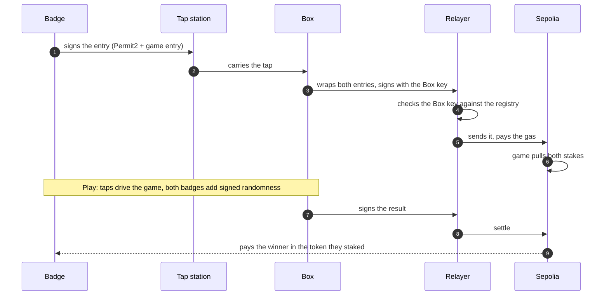

  

<h1 align="center">Ethereum Game Box</h1>

  A game console you play by tapping a badge. 
  Every match is staked and settled on Ethereum, and nobody at the table needs ETH, a wallet app or a single pop-up.

  ETHGlobal Mumbai 2026 &nbsp;·&nbsp; <a href="https://plans.georgekm.com/ethereum-game-box-2026-11-05/">Plan on the web</a> &nbsp;·&nbsp; <a href="index.html">Plan source</a>

  <a href="#what-it-is">What it is</a> &nbsp;·&nbsp;
  <a href="#how-it-works">How it works</a> &nbsp;·&nbsp;
  <a href="#games-and-the-token">Games and the token</a> &nbsp;·&nbsp;
  <a href="#partner-tracks">Partner tracks</a> &nbsp;·&nbsp;
  <a href="#how-we-get-there">How we get there</a>

 

> [!NOTE]
> **In one sentence:** the badge is the wallet, the Box is the referee, and Ethereum is the bank.

## What it is

### The problem

On-chain games ask too much before the fun starts: install a wallet, buy gas, approve a token, sign a prompt you
can't read. That works for one person at a desk. It doesn't work for four friends around a table, a booth at an
event, or a bar on a Friday night.

### The idea

The Game Box is a small console: a Raspberry Pi with a screen and a speaker, tap stations for the players, and a
hardware key inside that gives the Box its own identity on chain. Players carry NFC badges, each one a wallet whose
key never leaves the chip. **Tap to join, tap to stake, tap to play.**

### What a player does

1. **Walks up and taps.** The Box reads the badge's wallet and sends it test tokens. No ETH needed, ever: the Box
   pays the gas.
2. **Gets a name.** One more tap claims `name.gamebox.eth`, which follows the player from Box to Box.
3. **Picks a game and stakes.** A single tap signs the entry and moves the stake into the game contract. The screen
   shows who is in and what is at stake.
4. **Plays.** Taps are the controls: first to tap, pick a card, lock in a choice.
5. **Gets paid.** The Box signs the result, the chain checks it and pays the winner, all in about ten seconds. Big
   wins move titles like `champion.stockduel.gamebox.eth`.

### Who it's for

|  |  |
|---|---|
| **Players** | Real stakes and real ownership, with nothing to install and nothing to learn beyond "tap here". |
| **Operators** | Anyone can run a Box at a café, an event or at home, stake to it, and earn a share of every game played on it. |
| **Game makers** | One game interface: open, settle, refund. Write the rules, and the Box handles badges, stakes and payouts. |

### What we're building this weekend

- One working Box on the table, with two tap stations and a handful of badges.
- Real games with real stakes on Sepolia, settled in seconds.
- A token launched on Uniswap, whose fees feed back into the games.
- Names for every Box and every player on ENS, and a public site that reads them.

## How it works

### On the table

| Piece | What it is |
|---|---|
| **The Box** | A Raspberry Pi 5 with a touchscreen and a speaker. It runs the games, the screen and the sound, and talks to the chain. |
| **The Box key** | A HYP2003 USB token. Its P-256 key is made on the chip and never leaves it. Every result, entry and heartbeat the Box sends is signed by it. |
| **Tap stations** | One per player: an ESP32-S3 with an NFC reader, a tiny screen and a buzz motor, linked to the Box wirelessly. |
| **Badges** | Arx HaLo NFC chips. Each holds a wallet key that can sign typed messages (EIP-712) but can never be copied out. |

### In the cloud and on chain

| Piece | What it is |
|---|---|
| **Relayer** | A Cloudflare Worker that pays the gas. It sends only what the Box key signed, one transaction at a time per chain, and refuses anything else before spending a wei. |
| **Contracts on Sepolia** | The Box registry, the games, the token and its Uniswap pool, staking, and the names. All on one chain, so everything can call everything. |
| **ENS** | `gamebox.eth` names every Box and every player, and carries live titles like the current champion. |
| **Public site** | Reads ENS and the contracts to show Boxes, players and champions. No backend of its own. |

### Why the Box key matters

Ethereum can now check P-256 signatures natively: the `P256VERIFY` precompile, about 7,000 gas. So the Box doesn't
need a seed phrase or a hot wallet. A cheap hardware token, the same kind used for digital signatures in India,
becomes an on-chain identity. Contracts know which Box sent a result, and an operator can rotate or revoke that key at
any time.

### One match, end to end

- **Entry.** The badge signs one Permit2 message whose payload is the game entry. The game contract is the only
  spender, and it rebuilds the message from the entry, so nobody in between can change a thing.
- **Open.** The Box wraps both entries in a request signed by its key. The relayer checks that signature against the
  registry, then sends it. The game contract pulls both stakes.
- **Play.** Taps drive the game. Where a game needs chance, both badges add their own signed randomness, so neither
  the Box nor a player picks the outcome.
- **Settle.** The Box signs the result. The contract checks the signature, the round and the expiry, then pays the
  winner in the token they staked.
- **Safety net.** If the Box never settles, both players take their stakes back after a timeout.

### What you have to trust

Every game declares one of two tiers, and the Box shows it before anyone stakes.

| Tier | Meaning |
|---|---|
| **Verified** | The chain can check the result itself. Pots can be large, and a challenge window lets anyone prove a Box cheated and take its stake. |
| **Refereed** | Only the Box saw what happened, like who tapped first. Pots are capped, and the Box's stake backs its word. |

## Games and the token

### The games

| Game | How it plays | Tier |
|---|---|---|
| **Quick Draw** | The screen says "draw". First tap wins. The simplest game, and the first one we build end to end. | Refereed |
| **Stock Duel** | Best of three. Each player picks a stock; the two badges' randomness picks the stat (price, average price, 24-hour move or liquidity), read live from Robinhood Chain's stock pools. Cards flip together; a timer picks for a slow player. | Refereed, with a public replay proof |
| **Bet on X** | Two players state a claim the chain can check ("gas is under 2 gwei at block N"), offer odds, and both tap. A checker contract settles it from chain state. | Verified |
| **B17** | A heist on a vault. A bot keeps sending transactions; players buy ranges of its future nonce. Wider ranges cost more (width squared), and the narrowest range holding the live nonce takes the vault. | Verified |

Stock Duel is the main game. Its replay proof is the Robinhood block number and the exact pool reads for each round,
so anyone can recheck the result.

### The token

Games are staked in the Game Box token. It launches through Uniswap's Continuous Clearing Auction, which sets a fair
opening price and then seeds a Uniswap v4 pool. That pool carries our own hook, with three fee levels:

| Fee | When |
|--:|---|
| **1%** | Any normal swap. |
| **0.25%** | A swap made with a badge tap at a Box, up to a daily cap tied to that Box's stake. Playing in person earns the discount. |
| **0%** | Swaps made by the game contract itself, so the buyback costs nothing. |

The hook also keeps a time-weighted price, which v4 doesn't provide. The buyback and the operator auction use it, so
neither can be pushed around by one big trade.

### Where the fees go

Every settled game pays a small fee, split in half:

- **Half buys the token back and burns it,** through the pool at zero fee. More games, less supply.
- **Half goes to the Box,** shared between its operator and the people who staked to it.

### Boxes, operators and stakers

- **Operators** win the right to run a Box through an operator auction, priced from the pool's time-weighted price.
  The tokens they bid become the Box's stake.
- **Stakers** back a Box they trust and earn from its games. The operator sets a commission between 10% and 90%, and a
  change only takes effect after a delay.
- **Cheating costs stake.** Unstaking waits out a delay, and until it ends, a proven cheat can take the Box's stake.
- **The lobby** lets a player swap USDC for the token with one tap, at the tap fee, and stake to the Box in the same
  tap.

## Partner tracks

<b>Uniswap</b>: launch, hook, buyback, operator auction

- **Launch:** the token launches through the Continuous Clearing Auction into a v4 pool.
- **Hook:** our v4 hook sets the fee per swap: 1%, 0.25% with a badge tap and the Box's signature, 0% for the game
  contract. It also keeps the time-weighted price.
- **Buyback and burn:** every settled game swaps half its fee into the token and burns it.
- **Operator auction:** a second auction sells the right to run a Box, priced from the hook's time-weighted price.
- **Judges see:** a tap-discount swap at the Box, then a game settling and the burn landing on chain. We keep
  `FEEDBACK.md` as we go, as the track asks.

<b>ENS</b>: Box names, player names, live titles

- **Box names** like `mumbai-01.gamebox.eth` carry the Box's key and status, and expire with its licence.
- **Player names** are claimed with a tap and never expire. The badge owns its records, and the game may only write
  its stats.
- **Live titles:** `champion.stockduel.gamebox.eth` moves to each new winner, only after a signed win.
- **The site** reads everything from ENS: no database behind it.
- **Judges see:** they claim a name with their own tap, win a round, and watch the title move to them on the site.

<b>0G</b>: voice bets, a practice opponent, an audit log

- **Voice:** players speak a bet, and 0G turns it into terms the chain can check.
- **Practice opponent:** an AI player to learn against.
- **Decision log:** every AI decision is stored on 0G Storage with its request ID, so it can be audited.
- **Safe stop:** if 0G doesn't answer, the Box refuses. It never guesses.
- We add this once our 0G credits arrive; the rest of the plan doesn't depend on it.

### Chains

| Chain | What for |
|---|---|
| **Sepolia** | Every contract: Boxes, games, the token and its pool, staking, and the ENS names. |
| **Robinhood Chain** | Read only: the stock pools whose live prices drive Stock Duel. |

## How we get there

### How we work

- **One feature at a time, finished.** Contracts, the Box, the screen and the tests, then a run on the real Box with
  real badges. Only then does the next one start.
- **The demo always works.** Each milestone leaves something we could show. If time runs out, we cut from the end of
  the list, never from the middle.
- **A test page on the Box** gets a button for every new chain call, tap and signature, so each piece is checked on the
  hardware before it goes into a game.
- **Split where it's safe.** Once the first game works, the token, the names and staking touch separate contracts and
  can be built side by side.

### Milestones

| # | Milestone | What it adds | Done when |
|:-:|---|---|---|
| 1 | **The Box on chain** | The monorepo and deploy pipeline, the Box registry with its P-256 key, and the relayer. | The Box's token signs a heartbeat on the Pi, the relayer sends it, and a forged one is refused. |
| 2 | **First game** | Badges join and get tokens, one-tap staked entry, the game escrow with refunds, and Quick Draw. | Two badges play Quick Draw for stakes without holding any ETH, and the winner is paid. |
| 3 | **Stock Duel** | Live Robinhood Chain prices, two-badge randomness, best of three, and the replay proof. | A staked match runs on the Box with live prices, and its proof checks out. |
| 4 | **The token** | The auction launch, the fee hook, buyback and burn, lobby swaps, and staking to Boxes. | Each fee level shows on a real swap, and a settled game burns tokens and pays its stakers. |
| 5 | **Names** | Box and player names, the champion title, and the public site. | A new player claims a name, wins, and the site shows the title move. |
| 6 | **The network** | The operator auction, Bet on X, B17, and 0G once credits arrive. | An operator wins a licence and registers a Box; both new games play a round. |

### The demo

About four minutes, at the table:

1. A judge taps a badge, gets tokens and claims a name.
2. They swap at the tap discount in the lobby and stake into a Stock Duel.
3. They play best of three against one of us, with live stock prices.
4. The winner is paid in seconds, the fee is burned on chain, and the champion title moves on the site.

> [!IMPORTANT]
> **Before judging:** the token, pool and hook are live, the badges are charged, the Box is on stable Wi-Fi, and the
> relayer is funded.

### Submission

- [ ] This repo, public, with a README that points to the exact Uniswap contracts and lines.
- [ ] `FEEDBACK.md` and the Uniswap feedback form.
- [ ] The live site's link for ENS, and every contract address.
- [ ] A demo video under three minutes.

## Team

[beingentangled](https://github.com/beingentangled) ·
[saithyasivadas](https://github.com/saithyasivadas) ·
[Athuli7](https://github.com/Athuli7) ·
[lizgeorge1](https://github.com/lizgeorge1) ·
[0xgeorgemathew](https://github.com/0xgeorgemathew)

 

Ethereum Game Box · ETHGlobal Mumbai 2026

